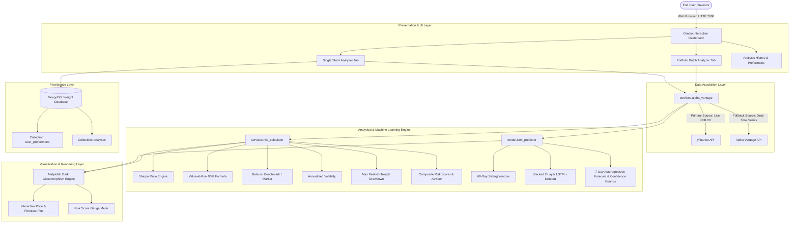

# 📊 FinSight AI — Technical Architecture & Engineering Documentation

**FinSight AI** is a production-grade, AI-driven financial advisor and risk analytics platform. It combines sequential deep learning (Recurrent Neural Networks / LSTM) for equity price trajectory forecasting with portfolio risk metrics (Sharpe Ratio, Value-at-Risk, Beta, Volatility, Max Drawdown) and interactive visual dashboards.

---

## 1. System Architecture Overview



---

## 2. Directory Structure

```text
FinSight/
├── app/
│   ├── __init__.py
│   ├── main.py                  # Core Gradio web UI application & handlers
│   └── data_fetcher.py          # Backward-compatibility bridge
├── services/
│   ├── __init__.py
│   ├── alpha_vantage.py         # Resilient data service (yfinance + Alpha Vantage)
│   └── risk_calculator.py       # Quantitative risk formulas & scoring logic
├── model/
│   ├── __init__.py
│   ├── lstm_predictor.py        # TensorFlow 2.x LSTM architecture & inference
│   └── saved_models/            # Serialized model weights & MinMaxScaler objects
│       ├── AAPL_lstm.keras      # Pre-trained Apple Inc. model
│       └── AAPL_scaler.pkl      # Pre-fit MinMax scaler
├── db/
│   ├── __init__.py
│   ├── mongo_connect.py         # MongoDB connection lifecycle manager
│   └── mongo_handler.py         # CRUD operations for preferences & historical logs
├── docker/
│   ├── Dockerfile               # Microservice container definition
│   └── docker-compose.yml       # Multi-container orchestration (App + Mongo)
├── utils/
│   ├── __init__.py
│   └── helpers.py               # Normalization, SMA, EMA, currency formatters
├── main.py                      # Global entrypoint (python main.py)
├── requirements.txt             # Pinned and validated dependencies
├── Dockerfile                   # Root Docker container file
├── README.md                    # Public documentation & badges
├── TECHNICAL_DOCUMENTATION.md   # Complete technical specifications
├── .env.example                 # Environment variables template
└── .gitignore                   # Security exclusion (API keys, venvs, caches)
```

---

## 3. Deep Learning Architecture: LSTM Time-Series Predictor

### 3.1 Network Topology
Stock prices are continuous sequential data with temporal autocorrelations. FinSight utilizes a **Stacked Long Short-Term Memory (LSTM)** neural network:

| Layer | Type | Specifications / Dimensions | Activation | Regularization |
|---|---|---|---|---|
| **Input** | Tensor | `(batch_size, 60, 1)` — 60-day historical window | — | — |
| **Layer 1** | `LSTM` | 50 Units, `return_sequences=True` | tanh / sigmoid | Dropout (p=0.20) |
| **Layer 2** | `LSTM` | 50 Units, `return_sequences=False` | tanh / sigmoid | Dropout (p=0.20) |
| **Dense 1** | `Dense` | 25 Neurons | ReLU | — |
| **Output** | `Dense` | 1 Neuron (Normalized Next-Day Close) | Linear | — |

* **Loss Function**: Mean Squared Error ($MSE = \frac{1}{n}\sum_{i=1}^{n}(y_i - \hat{y}_i)^2$)
* **Optimizer**: Adam ($\alpha=0.001$, $\beta_1=0.9$, $\beta_2=0.999$)
* **Convergence Control**: `EarlyStopping(monitor='val_loss', patience=5, restore_best_weights=True)`

### 3.2 7-Day Autoregressive Forecasting & Uncertainty Bands
To project multiple days into the future without lookahead leakage, the engine implements sliding-window autoregression:
$$\hat{p}_{t+1} = f(p_t, p_{t-1}, \dots, p_{t-59})$$
For $k \in \{2, \dots, 7\}$, predictions from prior steps feed back into the window.

Confidence boundaries are derived from the historical standard deviation of log returns ($\sigma_{\text{daily}}$):
$$\text{Upper Bound}_{t+k} = \hat{p}_{t+k} + 1.5 \cdot \sigma_{\text{hist}} \cdot p_0$$
$$\text{Lower Bound}_{t+k} = \hat{p}_{t+k} - 1.5 \cdot \sigma_{\text{hist}} \cdot p_0$$

### 3.3 Lazy Loading on Windows
TensorFlow DLL initialization on Windows can encounter library lockups during top-level Python import chains. FinSight implements **Lazy Module Import** inside `model/lstm_predictor.py`, allowing the web server to start instantly in sub-second time.

---

## 4. Quantitative Risk Analysis Engine

The risk engine computes industry-standard portfolio management metrics:

### 4.1 Sharpe Ratio (Risk-Adjusted Excess Return)
$$\text{Sharpe Ratio} = \sqrt{252} \cdot \frac{\mathbb{E}[R_p - R_f]}{\sigma(R_p - R_f)}$$
* Baseline Risk-Free Rate $R_f$: 5.0% annual (proxy for 10-Year US Treasury).
* Annualization Factor: $\sqrt{252}$ trading days.

### 4.2 Value-at-Risk (VaR 95% Parametric)
$$\text{VaR}_{95\%} = \left(\mu_{\text{daily}} - 1.65 \cdot \sigma_{\text{daily}}\right)$$
Measures the maximum expected single-day percentage decline at a 95% statistical confidence level.

### 4.3 Systematic Risk ($\beta$ - Beta)
$$\beta = \frac{\text{Cov}(R_{\text{asset}}, R_{\text{benchmark}})}{\text{Var}(R_{\text{benchmark}})}$$
Measures asset volatility relative to broader market movements (e.g. S&P 500 benchmark).

### 4.4 Maximum Drawdown
$$\text{MDD} = \max_{t \in [0, T]} \left( \frac{\text{Peak}_t - P_t}{\text{Peak}_t} \right)$$
Evaluates the largest peak-to-trough decline over the selected timeframe.

### 4.5 Composite Risk Scoring Algorithm
Metrics are normalized into a calibrated scale between $1.0$ and $10.0$:
$$\text{Score} = 0.40 \cdot \text{VolScore} + 0.40 \cdot \text{VaRScore} + 0.20 \cdot \text{SharpePenalty}$$
* **Low Risk ($\le 3.5$)**: Green indicator. Suitable for conservative portfolios.
* **Moderate Risk ($3.5 - 6.5$)**: Amber indicator. Balanced profile.
* **High Risk ($> 6.5$)**: Red indicator. High volatility / speculative exposure.

---

## 5. Deployment & Execution Instructions

### Local Development Setup
```bash
# 1. Clone repository
git clone https://github.com/deeneshkumar/FinSight.git
cd FinSight

# 2. Activate Python environment
python -m venv venv
# Windows:
venv\Scripts\activate
# Linux/macOS:
source venv/bin/activate

# 3. Install dependencies
pip install -r requirements.txt

# 4. Configure environment (optional)
cp .env.example .env

# 5. Launch web application
python main.py
```
Open **`http://localhost:7860`** in any web browser.

### Docker Multi-Container Deployment
```bash
# Build and start both FinSight app and MongoDB service
docker-compose -f docker/docker-compose.yml up --build -d

# Verify containers are running
docker ps
```
The application will be accessible on `http://localhost:7860` with MongoDB accessible on port `27017`.
